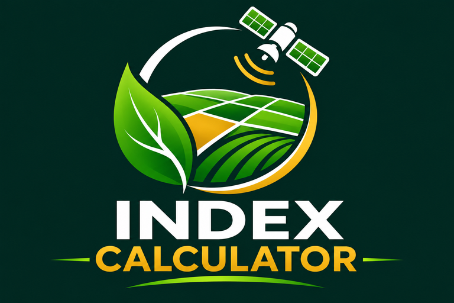

# Index Calculator Pro 5.5.1

Extension QGIS de télédétection agricole, écrite et maintenue par Allaye GUINDO.

- Auteur : Allaye GUINDO
- GitHub : https://github.com/guindoallayecontact7/index-calculator-qgis
- Licence : GNU GPL v2

## Présentation

Index Calculator Pro garde tout le travail dans une seule fenêtre : télécharger
une scène pour une zone, vérifier les bandes, calculer les indices spectraux,
puis lire les parcelles. Les traitements tournent en local. Le réseau ne sert
qu'au téléchargement facultatif des scènes.

## Fonctions

- **Téléchargement en ligne** : recherche de scènes Sentinel-2 L2A et Landsat 4-9
  (TM, ETM+, OLI/TIRS) Collection 2 L2 sur une période et un taux de nuages. Le
  type de produit peut couvrir toutes les missions Landsat ou une seule
  génération (4-5, 7 ou 8-9). La zone d'intérêt peut venir de la
  couche active, d'un fichier GeoJSON/SHP/GPKG ou d'un rectangle tracé sur la
  carte. Seule cette zone est téléchargée en bandes GeoTIFF, prêtes pour le
  calcul. Avec une limite vectorielle, les pixels hors limite sont masqués en
  NoData 0 dès le téléchargement. Aucun compte n'est nécessaire (catalogues STAC
  publics).
- **Aperçu avant téléchargement** : un bouton (ou un double-clic sur la ligne)
  affiche le quicklook de la scène sélectionnée.
- **Correction automatique facultative** : conversion des nombres numériques en
  réflectance, retrait de la brume par soustraction du sombre objet sur les
  bandes visibles et remise à l'échelle commune des scènes à faible contraste.
  Elle ne s'applique que lorsque les données le justifient.
- **Calculateur de 80 indices** : détection automatique des bandes Sentinel-2 et
  Landsat 4-9, rééchantillonnage, masque nuages, coloration et lecteur de
  formules.
- **Filtre et préréglages d'indices** : recherche par nom ou catégorie et
  sélection en un clic d'une famille d'indices.
- **Raster Insight** : statistiques et lecture préliminaire de la couche active.
- **Boîte à outils Traitement (55 algorithmes)** :
  - bibliothèque d'indices spectraux (25 algorithmes) ;
  - statistiques zonales, suivi de culture, séries temporelles, détection de
    stress et classement de parcelles ;
  - registre des méthodes scientifiques et banc de tests numériques ;
  - audit raster et contrôle d'alignement ;
  - compatibilité capteur et cartographie automatique des bandes ;
  - harmonisation raster et alignement GDAL Warp sur une grille de référence ;
  - pipeline de prétraitement, masques nuages et ombres, masque QA ;
  - délimitation de parcelles, extraction de limites, analyse de forme, fusion,
    topologie, affinage des candidats et classification des motifs de culture.

## Interface

Trois onglets : IMAGE, PROCESSING et INDICES.

Le panneau **Download products** est organisé en cinq sections : Product search
(type de produit, dates, couverture nuageuse), Area of interest (coordonnées
Nord/Sud/Est/Ouest, couche active, fichier de limite ou rectangle tracé sur la
carte), Product list (tableau Date / Cloud cover / Product ID, bouton de
prévisualisation), Download (répertoire de sortie, bouton, barre de progression)
et Log (journal des opérations).

## Indices

80 indices répartis en huit catégories : végétation (27), chlorophylle et red edge
(6), eau et humidité (12), sol (11), stress (8), culture (8), incendie (4) et
bâti (4). La liste complète figure dans `metadata.txt` et dans le lecteur de
formules de l'extension.

## Installation

QGIS > Extensions > Gérer et installer les extensions > Installer depuis un ZIP.

## Dépendances

QGIS 3.16+ (testé sur 3.44 LTR), GDAL et numpy fournis par QGIS. Une connexion
Internet est nécessaire uniquement pour le téléchargement en ligne des scènes.

## Statut de validation (5.5.1, stable)

- Import de tous les modules Python : OK.
- Enregistrement du provider Processing : 55 algorithmes, aucun doublon.
- Calcul des 80 indices sur bandes synthétiques : OK.
- Dialogue principal en onglets Image / Processing / Indices, filtre et
  préréglages de catégorie : OK.
- Recherche STAC et téléchargement réel d'une scène Sentinel-2 (11 bandes),
  Landsat 8-9 (7 fichiers) et Landsat 7 (7 fichiers) sur une petite zone : OK.
- Aperçu réel d'une scène Landsat 7 (quicklook Planetary Computer) : OK.
- Correction automatique testée sur une scène Landsat 7 : conversion en
  réflectance Collection 2 et calcul des indices sans valeur aberrante : OK.
- Correspondance des bandes Landsat 4-7 (B1 à B5, B7) et 8-9 (B2 à B7) : OK.
- Découpe sur limite testée sur une scène réelle avec un polygone triangulaire :
  emprise réduite, 50 % de pixels masqués en NoData 0.
- Contrôles de sécurité : tous les appels réseau passent par une seule fonction
  HTTPS, redirections non HTTPS refusées, URL de bandes non HTTPS ignorées,
  emprise validée en WGS84, archive sans binaire ni chemin absolu. Scan Bandit
  du dépôt QGIS : aucun constat.
- Calcul des indices sur la scène téléchargée : OK.
- Non testé : interface complète sur données Sentinel-2/Landsat réelles
  (chargement, style, worker) et compatibilité QGIS 4.x / PyQt6.

## Limites

Raster Insight et les scores produits sont descriptifs, pas des diagnostics
agronomiques. Les seuils d'indices sont indicatifs et doivent être calibrés selon
la culture, le stade phénologique, le capteur, la date et les conditions locales.

Le téléchargement en ligne découpe les bandes sur la limite vectorielle quand
une couche ou un fichier de limite est utilisé ; un rectangle tracé manuellement
ou des coordonnées saisies restent limités au rectangle englobant.
